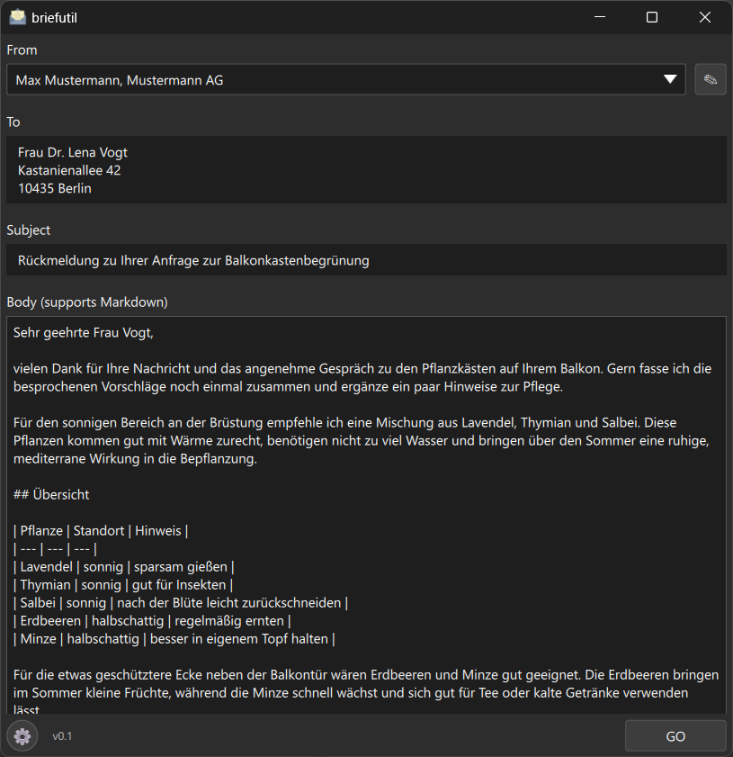
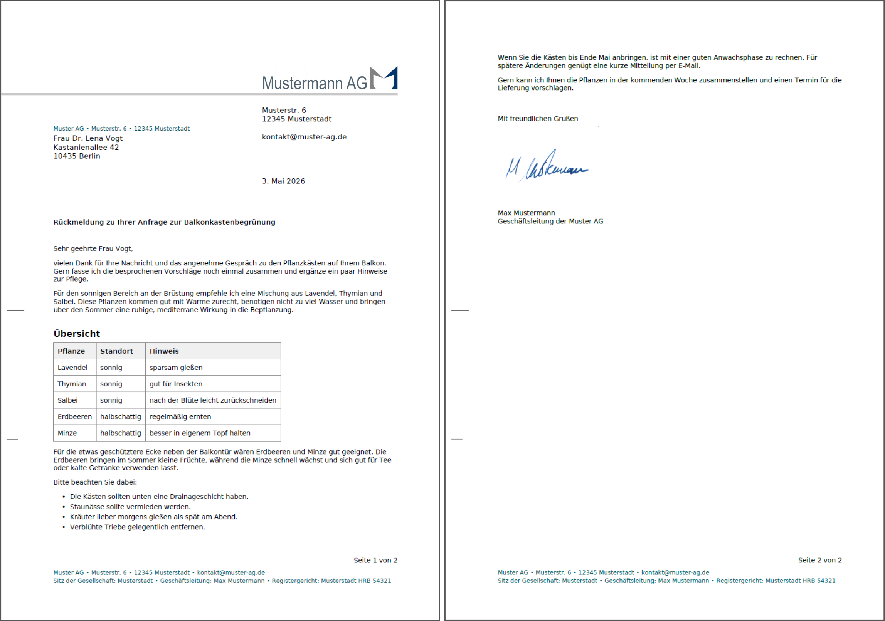

# briefutil

`briefutil` is a small utility for turning short letters into PDF files. It
ships as both a Qt Quick desktop app and a CLI.

<p align="center">
  
</p>

The letter above produces a PDF like this:

<p align="center">
  
</p>

## What it does

- selects JSON sender profiles and collects recipient, subject, and body text
- supports Markdown in letter bodies
- generates DIN 5008 form A/B and US Letter PDFs
- includes TrueType fonts and supports custom fonts
- provides `briefutil_cli` for scriptable PDF generation

## Build and run

You need CMake 3.24 or newer, a C++20 compiler, and Qt 6. From the repository
root, set `CMAKE_PREFIX_PATH` to the Qt installation for your compiler:

```powershell
cmake -S briefutil -B briefutil/build -DCMAKE_PREFIX_PATH="C:/Qt/6.x/<toolchain>"
cmake --build briefutil/build --config Release
```

With a Windows multi-config generator such as Visual Studio, start the app with:

```powershell
briefutil/build/app/Release/briefutil.exe
```

Select a sender profile, enter the recipient, subject, and body, then generate
the PDF. For requirements, other build variants, installation, and portable
packages, see [Building and packaging](docs/building.md).

## CLI letters

Save the letter body as UTF-8 text in `body.md`, then run:

```powershell
briefutil/build/cli/Release/briefutil_cli.exe `
  --to "Ioannis Makris\nAm Zirkus 3\n10117 Berlin" `
  --subject "Example letter" `
  --body-file body.md `
  --output example.pdf
```

See [Letter usage and configuration](docs/usage.md) for CLI options, sender
profiles, data locations, Markdown support, and font settings.

## Invoices

The CLI also renders invoice and credit-note PDFs from exported orders and
local templates. See [the invoice workflow and JSON contract](docs/invoices.md)
for generation, review, and the handoff to the order service.

## Contributing and license

Contributions follow the [Varinomics coding standards](https://github.com/Varinomics/varinomics-standards).
Build and test instructions are in [Building and packaging](docs/building.md#tests).

Source code is provided under the Simplified BSD License. See
[LICENSE.txt](LICENSE.txt).
